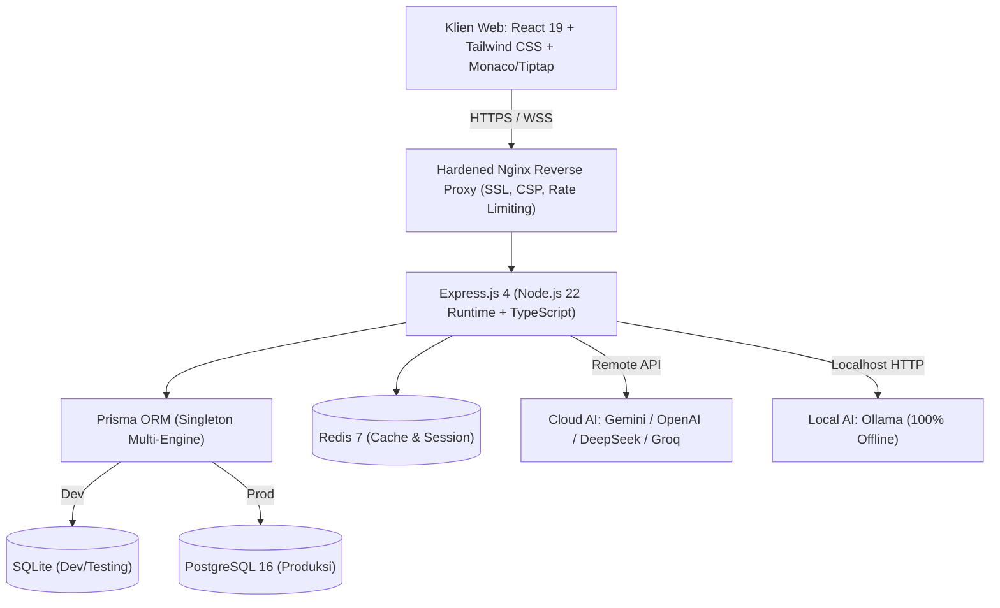

# 🌿 RuangTenang Kampus
### *Ekosistem Terpadu Kesehatan Mental Mahasiswa, Pendamping AI Reflektif & RuangKerja Kolaboratif*

[](https://github.com/irsyadazaki77-beep/RuangTenang)
[](https://www.typescriptlang.org/)
[](https://react.dev/)
[](https://expressjs.com/)
[](https://www.prisma.io/)
[](https://www.postgresql.org/)
[](https://www.docker.com/)
[](https://tailwindcss.com/)

---

## 📖 Tentang RuangTenang Kampus

**RuangTenang Kampus** adalah platform digital komprehensif yang dirancang untuk mendukung kesehatan emosional, kesejahteraan psikologis, dan produktivitas sivitas akademika perguruan tinggi. Mengintegrasikan teknologi kecerdasan buatan etis dengan alur rujukan manusia profesional, RuangTenang menjembatani kebutuhan pendampingan mental harian dengan layanan bimbingan konseling universitas secara aman, privat, dan terenkripsi.

Platform ini mengusung dua ruang kerja utama:
1. **RuangTenang:** Suaka refleksi diri, pelacak suasana hati (*mood tracker*), skrining mandiri tervalidasi (PHQ-9 & GAD-7), pusat krisis darurat (SOS 24/7), serta penjadwalan konseling tatap muka / daring bersama konselor kampus.
2. **RuangKerja & Artifact Studio:** Ruang produktivitas kognitif berbasis AI untuk eksplorasi akademis, penyusunan rencana studi, visualisasi diagram alir Mermaid, penulisan rumus KaTeX/LaTeX, serta pengeditan dokumen langsung (Monaco Editor & Rich-Text Tiptap) yang dapat diekspor ke berbagai format dokumen (DOCX, PPTX, PDF, Excel).

> [!IMPORTANT]
> **Pernyataan Etika & Batasan Medis:**  
> Asisten AI RuangTenang adalah pendamping reflektif emosional awal dan **BUKAN** pengganti diagnosis klinis psikolog atau psikiater. Skrining mandiri bersifat indikatif dan setiap kondisi gawat darurat diarahkan langsung ke kontak krisis profesional kampus dan fasilitas rujukan medis darurat.

---

## ✨ Fitur-Fitur Unggulan

### 1. 🧘 Teman RuangTenang (Asisten AI Reflektif & Aman)
* **Pendekatan *Reflective Listening* & CBT:** AI dilatih untuk memvalidasi perasaan dan memantik refleksi kognitif sehat tanpa memberikan penghakiman (*non-judgmental*).
* **Penyaringan PII Otomatis:** Sistem mendeteksi dan menyaring informasi pribadi sensitif (seperti NIK, nomor telepon, alamat) sebelum pesan dikirim ke model AI.
* **Deteksi Risiko Berlapis & Protokol SOS:** Mendeteksi indikasi krisis atau niat menyakiti diri sendiri secara *real-time*, langsung mengaktifkan kartu bantuan darurat dan kontak rujukan kampus.
* **Multi-Provider AI Flexible:** Mendukung **Google Gemini**, **OpenAI**, **DeepSeek**, **Groq**, **OpenRouter**, hingga **Ollama (100% Offline / Local AI)** untuk privasi penuh.

### 2. 📅 Sistem Penjadwalan Konseling Real-Time
* **Pencegahan *Double-Booking*:** Transaksi database tingkat server mencegah tabrakan jam temu antar-mahasiswa.
* **Multi-Zona Waktu:** Penyesuaian otomatis untuk wilayah **WIB**, **WITA**, dan **WIT**.
* **Alur Persetujuan Terstruktur:** Status temu transparan (`PENDING` ➔ `CONFIRMED` ➔ `COMPLETED` / `CANCELLED`).
* **Integrasi Notifikasi:** Pengingat otomatis melalui email dan integrasi WhatsApp (Twilio).

### 3. 📋 Skrining Mandiri & Pelacak Tren Emosi
* **Instrumen Psikometrik Baku:** Skrining tervalidasi menggunakan kuesioner **PHQ-9** (gejala depresi) dan **GAD-7** (gejala kecemasan).
* **Kalkulasi & Skor Otomatis:** Algoritma pengelompokan tingkat keparahan (*minimal*, *ringan*, *sedang*, *berat*) disertai rekomendasi tindakan tindak lanjut.
* **Visualisasi Riwayat Emosi:** Grafik tren mingguan/bulanan yang aman dan hanya dapat diakses oleh mahasiswa yang bersangkutan.

### 4. 🎨 RuangKerja & Artifact Studio
* **Interaksi Kanvas Dua Panel:** Panel obrolan pemikiran AI di sisi kiri bersanding dengan kanvas artefak interaktif di sisi kanan.
* **Editor Multi-Format:** Monaco Code Editor untuk pemrograman dan Tiptap Rich-Text Markdown untuk penulisan esai atau laporan.
* **Rendering Matematis & Diagram:** Dukungan penuh untuk sintaks KaTeX/LaTeX dan visualisasi bagan Mermaid.js.
* **Ekspor Dokumen Cepat:** Konversi artefak ke berkas nyata: **DOCX**, **PPTX**, **PDF**, dan **Excel (XLSX)** sekali klik.
* **Riset Akademis Terbimbing:** Integrasi pencarian sitasi resmi via Crossref dan pencarian riset web Tavily (opsional).

### 5. 🛡️ Keamanan Data & Privasi (Privacy by Design)
* **Enkripsi AES-256-GCM:** Mengamankan catatan konseling rahasia dan jurnal pribadi menggunakan enkripsi amplop (*envelope encryption*) dengan rotasi kunci server.
* **Isolasi Multi-Tenant Kampus:** Setiap universitas memiliki panel kelola mandiri dengan batasan isolasi data (*data residency*) dan agregasi analitik berbasis *k-anonymity*.
* **Arsitektur Non-PWA:** Tidak menyimpan riwayat psikologis sensitif di cache publik browser atau Service Worker offline yang berisiko diakses pada komputer bersama (*shared PC* perpustakaan).

---

## 🏛️ Arsitektur & Tech Stack



| Layer | Komponen Teknologi |
| :--- | :--- |
| **Frontend UI** | React 19, TypeScript, Tailwind CSS, Motion, Lucide Icons, Recharts, KaTeX |
| **Artifact Studio** | Monaco Editor, Tiptap Editor, Mermaid.js, Docx, Pptxgenjs, Pdfkit, ExcelJS |
| **Backend API** | Express.js 4, Node.js 22, tsx, Zod, Helmet, Express-Rate-Limit, Compression |
| **Database & ORM** | Prisma ORM 6, SQLite (Lokal), PostgreSQL 16 (Produksi), Redis 7 (Caching) |
| **AI Providers** | `@google/genai`, OpenAI, DeepSeek, Groq, OpenRouter, Ollama |
| **Security & Crypt** | AES-256-GCM, Bcryptjs, JsonWebToken, Strict CSP & HSTS |
| **Deployment** | Multi-Stage Docker, Docker Compose, Nginx 1.27 Alpine |

---

## ⚡ Panduan Instalasi & Menjalankan Proyek

### 1. Prasyarat Sistem
* **Node.js**: Versi `>= 22.12.0` (LTS direkomendasikan)
* **npm**: Versi `>= 10.0.0`
* **Docker & Docker Compose** (Opsional, untuk pengujian stack container produksi)

---

### 2. Cara Cepat di Windows (One-Click Launchers)
Tersedia berkas batch otomatis siap pakai:
* Dobel klik **`Mulai RuangTenang.bat`** — Melakukan instalasi dependensi, sinkronisasi skema database, dan menjalankan server secara otomatis.
* Dobel klik **`Mulai RuangTenang (Mode Dev).bat`** — Menjalankan mode pengembangan dengan live hot-reload.
* Dobel klik **`Mulai RuangTenang (Mode Ringan).bat`** — Menjalankan versi hemat sumber daya (RAM rendah).

---

### 3. Instalasi Manual via Terminal

#### Langkah 1: Kloning Repositori
```bash
git clone https://github.com/irsyadazaki77-beep/RuangTenang.git
cd RuangTenang
```

#### Langkah 2: Instal Dependensi
```bash
npm ci
```
> Pastikan menggunakan `npm ci` untuk menjamin konsistensi versi paket sesuai `package-lock.json`.

#### Langkah 3: Konfigurasi File Lingkungan (`.env`)
Salin file template lingkungan:
```bash
cp .env.example .env
```
Buka file `.env` dan lengkapi konfigurasi kunci yang diperlukan (seperti `JWT_SECRET`, `ENCRYPTION_KEY`, dan API Key AI yang Anda miliki).

#### Langkah 4: Inisialisasi Database Lokal (SQLite)
Aplikasi menggunakan SQLite untuk lingkungan pengembangan lokal:
```bash
# Push skema ke database SQLite lokal
npm run db:push:sqlite

# (Opsional) Mengisi data contoh akun demo konselor & mahasiswa
npm run seed:demo
```

#### Langkah 5: Jalankan Server Pengembangan
```bash
npm run dev
```
Akses platform melalui browser di: `http://localhost:5173` atau `http://localhost:3000`.

---

## 🔒 Menjalankan Mode AI 100% Lokal (Ollama)

Jika institusi Anda menghendaki privasi data maksimum tanpa lalu lintas AI yang keluar ke internet (*zero external data egress*), Anda dapat menggunakan **Ollama**:

1. Pastikan [Ollama](https://ollama.ai/) telah terpasang dan berjalan di mesin Anda (`ollama serve`).
2. Unduh model pilihan (misal: `ollama run llama3.2`).
3. Set variabel berikut di file `.env`:
   ```env
   LOCAL_AI_ONLY=true
   OLLAMA_BASE_URL=http://127.0.0.1:11434
   ```
4. Verifikasi kesiapan adapter lokal dengan perintah:
   ```bash
   npm run check:local-ai
   ```

---

## 🧪 Rangkaian Pengujian Kualitas (Quality Gates)

Untuk memastikan keandalan, keamanan, dan kompatibilitas sistem sebelum rilis, jalankan pengujian berikut:

```bash
# 1. Pemeriksaan Kesesuaian Tipe TypeScript
npm run typecheck

# 2. Audit Kode & Keamanan Sintaks (ESLint)
npm run lint

# 3. Pengujian Unit Komponen & Algoritma
npm run test:unit

# 4. Pengujian Integrasi Database & API
npm run test:integration

# 5. Pengujian Keamanan (Auth, CORS, Rate Limit, Injeksi)
npm run test:security

# 6. Pengujian End-to-End Browser (Playwright)
npm run test:e2e

# 7. Verifikasi Performance & Bundle Budget
npm run check:perf
```

---

## 🐳 Panduan Deployment Produksi (Docker & Nginx)

RuangTenang siap dipublikasikan ke server produksi menggunakan arsitektur container yang telah diperkuat (*hardened*):

### 1. Persiapan Berkas Produksi
```bash
cp .env.production.example .env.production
chmod 600 .env.production
nano .env.production
```

### 2. Eksekusi Otomasi Deployment (`deploy.sh`)
```bash
chmod +x deploy.sh
./deploy.sh
```
Skrip `deploy.sh` akan secara otomatis melakukan:
1. Validasi pre-flight & pemeriksaan integritas berkas.
2. Backup snapshot database berjalan.
3. Build container image multi-stage yang ramping.
4. Menjalankan migrasi database PostgreSQL via Prisma (`prisma migrate deploy`).
5. Melakukan *rolling restart* container tanpa *downtime*.
6. Melakukan verifikasi healthcheck API endpoint.

### 3. Perintah Operasional Docker
* Cek status layanan: `docker compose -f docker-compose.prod.yml ps`
* Pantau log aplikasi: `docker compose -f docker-compose.prod.yml logs -f web`
* Pantau log reverse proxy: `docker compose -f docker-compose.prod.yml logs -f proxy`
* Matikan layanan: `docker compose -f docker-compose.prod.yml down`

---

## 📚 Dokumentasi Teknis Lanjutan

Untuk membaca panduan arsitektur dan operasional mendalam, silakan buka direktori [`docs/`](docs/):

* [Dokumentasi API Lengkap](docs/API.md) — Spesifikasi endpoint RESTful & WebSocket.
* [Operasional Multi-Kampus](docs/MULTI_CAMPUS_OPERATIONS.md) — Panduan provisioning tenant kampus & isolasi data.
* [Panduan Migrasi Database](docs/DATABASE_MIGRATIONS.md) — Prosedur migrasi aman SQLite & PostgreSQL.
* [Pedoman Keamanan & Pengerasan](docs/SECURITY_HARDENING.md) — Arsitektur enkripsi, CSP, dan mitigasi ancaman.
* [Skor & Skrining Klinis](docs/CLINICAL_SCREENING_SCORING.md) — Metodologi penentuan skor PHQ-9 & GAD-7.
* [Model Interaksi RuangKerja](docs/WORKSPACE_INTERACTION_MODEL.md) — Panduan sistem kanvas & lifecycle artefak.
* [Perawatan Harian Sistem](docs/DAILY_MAINTENANCE.md) — Runbook backup, audit log, dan retensi data.

---

## 🤝 Berkontribusi

Kami menyambut baik kontribusi dari komunitas pengembang, akademisi, dan praktisi kesehatan mental!

1. *Fork* repositori ini.
2. Buat branch baru untuk fitur Anda (`git checkout -b fitur/fitur-baru`).
3. Pastikan seluruh pengujian lolos (`npm run typecheck && npm run test:unit`).
4. Commit perubahan Anda (`git commit -m 'feat: menambahkan instrumen skrining stres akademis'`).
5. *Push* ke remote branch Anda (`git push origin fitur/fitur-baru`).
6. Buka **Pull Request** dengan deskripsi yang jelas.

---

## 📜 Lisensi & Kerahasiaan

Hak Cipta © 2026 **RuangTenang Kampus**.  
Dikembangkan untuk pengabdian sivitas akademika dan kesejahteraan mental mahasiswa Indonesia. Seluruh hak cipta dilindungi undang-undang.
